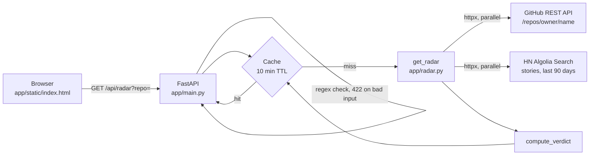

# Community Radar

Is your GitHub repo gaining **real traction**, riding **hype**, being a **quiet builder**, or **dormant**?
Community Radar combines GitHub repo stats with Hacker News mentions from the last 90 days and gives a verdict that is always the same for the same inputs.

```http
GET /api/radar?repo=owner/name
```

The same app serves a one-page frontend at `/`.

## Setup

```bash
python3.12 -m venv .venv && source .venv/bin/activate
pip install -r requirements-dev.txt
export GITHUB_TOKEN=ghp_...        # optional, but recommended for higher API rate limits
uvicorn app.main:app --reload      # http://localhost:8000
pytest                             # run tests
```

### Docker

```bash
docker build -t community-radar .
docker run -p 8000:8000 -e GITHUB_TOKEN=$GITHUB_TOKEN community-radar
```

## Environment variables

| Variable | Required | Purpose |
| --- | --- | --- |
| `GITHUB_TOKEN` | No | GitHub personal access token (no scopes needed for public repos). Raises the rate limit from 60 to 5,000 requests/hour. It is read only on the server and never sent to the browser. |

## Architecture



## Sample Response

```json
{
    "repo": "astral-sh/uv",
    "verdict": "real_traction",
    "reason": "365 HN points and 91023 stars.",
    "github": {
        "full_name": "astral-sh/uv",
        "url": "https://github.com/astral-sh/uv",
        "stars": 91023,
        "forks": 3686,
        "open_issues": 2983,
        "pushed_at": "2026-10-22T16:33:30Z"
    },
    "hn": {
        "stories": 4,
        "points": 365,
        "comments": 164,
        "top_story": {
            "title": "uv: Deduplicate all files in the wheel cache",
            "points": 231,
            "url": "https://news.ycombinator.com/item?id=49506142"
        }
    },
    "warnings": [],
    "cached": false
}
```

## Verdict rules

The rules are checked in this order. The thresholds are constants at the top of [app/radar.py](app/radar.py).

| Verdict | Rule |
| --- | --- |
| `dormant` | Last push was more than 180 days ago |
| `real_traction` | At least 100 HN points in 90 days **and** at least 1,000 stars |
| `hype` | At least 100 HN points but fewer than 1,000 stars |
| `quiet_builder` | Everything else: recently active with little HN buzz |

HN points are summed over the matching stories among the top 100 HN search results for `owner/name`. A story matches when its title, URL or text contains `owner/name` as a whole repo name, ignoring case. For example, `facebook/react` doesn't match `facebook/react-native`.

## API Free-tier limits

| Service | Limit |
| --- | --- |
| GitHub REST API | 60 requests/hour per IP without a token; 5,000/hour with `GITHUB_TOKEN` |
| HN Algolia API | About 10,000 requests/hour per IP. No key needed. |

Each radar lookup that isn't already cached makes one GitHub call and one HN call, or up to two of each when a call is retried. The 10-minute cache keeps repeated lookups of the same repo from using up these limits.

## Error handling

| Situation | Behavior |
| --- | --- |
| Invalid `repo` (must match `owner/name`) | `422` (FastAPI validation error) |
| Upstream timeout, network error or 5xx | Each call has a 5s timeout and is retried once |
| HN fails after the retry | `200` with GitHub data, `"hn": null`, `"warnings": ["hn_unavailable"]`. The verdict treats HN buzz as zero. Partial results aren't cached. |
| GitHub rate limit | `429` with `{"error": "github_rate_limited", "message": "...", "reset_at": "<ISO-8601 UTC>"}`. `reset_at` is `null` when GitHub doesn't say when the limit resets. |
| Repo not found | `404` with `{"error": "repo_not_found", "message": "..."}` |
| Repo renamed or transferred | GitHub's redirect is followed, and `repo` in the response is the new `owner/name` |
| GitHub fails for any other reason, including an invalid `GITHUB_TOKEN` | `502` with `{"error": "github_unavailable", "message": "..."}` |

The frontend has four states: loading, success, partial (yellow warning banner when HN is down), and error (red banner, which shows the rate-limit reset time when that is the cause).

## Notes

- The cache is in memory and per process. It is lost on restart, and each worker has its own cache.
