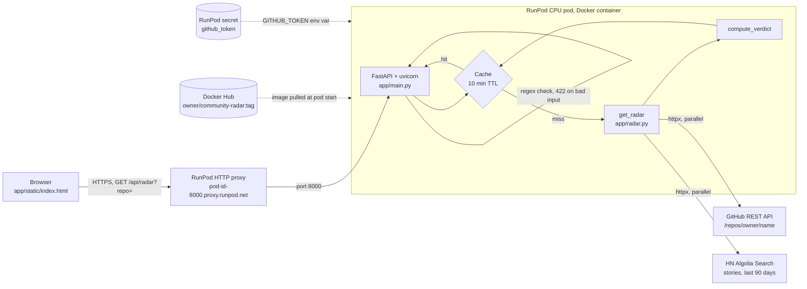

# Community Radar

Is your GitHub repo gaining **real traction**, riding **hype**, being a **quiet builder**, or **dormant**?
Community Radar combines GitHub repo stats with Hacker News mentions from the last 90 days and applies fixed rules to give a verdict. The same stars, HN points and last-push date always give the same verdict, with no LLM involved. The data is live, so a repo's verdict can change as it gains stars or as old HN stories leave the 90-day window.

```http
GET /api/radar?repo=owner/name
```

The same app serves a one-page frontend at `/`. It shows the verdict as a color-coded badge, with the reason and the rule behind it. Results can be shared as links like `/?repo=astral-sh/uv`.

**Live:** <https://iwbkmzje6u7rlw-8000.proxy.runpod.net> (try `/api/radar?repo=astral-sh/uv`)

## Setup

```bash
python3.12 -m venv .venv && source .venv/bin/activate
pip install -r requirements-dev.txt
export GITHUB_TOKEN=ghp_...        # optional, but recommended for higher API rate limits
uvicorn app.main:app --reload      # http://localhost:8000
pytest                             # run tests
```

### Docker

```bash
docker build -t community-radar .
docker run -p 8000:8000 -e GITHUB_TOKEN=$GITHUB_TOKEN community-radar
```

To deploy the image, see [Deploy to RunPod](#deploy-to-runpod).

## Testing

```bash
pytest
```

The tests mock GitHub and HN with `respx`, so they make no network calls and need no token. They cover:

- **Verdicts:** each of the four verdicts from stars, last push and HN points, and a `reason` that states the rule behind each one.
- **HN matching:** only stories that mention `owner/name` as a whole repo name count (for example, `acme/widget` doesn't match `acme/widgetry`), and stories with `null` points are handled.
- **Caching:** a repeat lookup, in any capitalization, is served from the cache without new upstream calls and keeps the original `checked_at`.
- **Retries and HN failures:** a 5xx is retried once, and when HN is down the response still has GitHub data and an `hn_unavailable` warning.
- **GitHub errors:** primary and secondary rate limits (`429` with `reset_at`), repo not found (`404`), renamed repos (redirect followed), an invalid token, and other failures (`502`).
- **Input validation:** malformed `repo` values, including `acme/..`, return `422`.

## Environment variables

| Variable | Required | Purpose |
| --- | --- | --- |
| `GITHUB_TOKEN` | No | GitHub personal access token (no scopes needed for public repos). Raises the rate limit from 60 to 5,000 requests/hour. It is read only on the server and never sent to the browser. |

## Deploy to RunPod

You need Docker with `buildx`, a Docker Hub account, [`jq`](https://jqlang.org) (`brew install jq`, used to read the pod logs) and a [RunPod API key](https://console.runpod.io/user/credentials) (create one under the **API Keys** tab).

### 1. Build and push the image

Build for RunPod's x86 machines, even on an Apple silicon Mac:

```bash
docker login
docker buildx build --platform linux/amd64 \
  -t <dockerhub-user>/community-radar:0.1.0 --push .
```

The image is public on Docker Hub, so RunPod can pull it without registry credentials. It contains only the app code, not your token. To keep it private instead, add your Docker Hub credentials in RunPod and pass `--registry-auth-id` to `pod create` (find the ID with `runpodctl registry list`).

### 2. Install and configure the RunPod CLI

```bash
brew install runpod/runpodctl/runpodctl     # Linux: wget -qO- cli.runpod.net | sudo bash
runpodctl doctor                            # asks for your RunPod API key and saves it
```

`runpodctl doctor` saves the key to `~/.runpod/config.toml` and prints a JSON report that should end with `"healthy": true`. On the first run, the `api_key` check shows `"error": "no api key configured"` next to `"fixed": true`. That means the key was missing and is now saved. `doctor` also creates an SSH key in `~/.runpod/ssh/` and adds it to your RunPod account. This app doesn't need it, because the image has no SSH server.

### 3. Create the pod

`GITHUB_TOKEN` is optional, but without it GitHub allows only 60 requests an hour, shared with everything else on the pod's IP address (see [Environment variables](#environment-variables)). To use one, create a RunPod secret named `github_token` in the RunPod console under **Secrets** before running the command below. The `--env` line passes that secret to the app. To run without a token, leave out the `--env` line.

```bash
runpodctl pod create \
  --name community-radar \
  --compute-type cpu \
  --image <dockerhub-user>/community-radar:0.1.0 \
  --ports 8000/http \
  --container-disk-in-gb 5 \
  --env '{"GITHUB_TOKEN":"{{ RUNPOD_SECRET_github_token }}"}'
```

The command prints the new pod as JSON. Shortened example:

```jsonc
{
  "containerDiskInGb": 5,
  "costPerHr": 0.08,
  "desiredStatus": "RUNNING",
  "env": {
    "GITHUB_TOKEN": "{{ RUNPOD_SECRET_github_token }}",
    "PUBLIC_KEY": "ssh-rsa AAAA... runpodctl-ssh-key"
  },
  "id": "abc123xyz45678",  // <-- the pod ID
  "imageName": "<dockerhub-user>/community-radar:0.1.0",
  "name": "community-radar",
  "ports": ["8000/http"],
  "vcpuCount": 2
}
```

`id` is the pod ID you use in the URL and in the commands below. `env` shows the secret placeholder, not your token, which is expected: RunPod fills in the secret when the container starts. `PUBLIC_KEY` is the SSH key that `runpodctl doctor` added, and this app doesn't use it.

When the pod is running, the app is at `https://<pod-id>-8000.proxy.runpod.net`, for example `https://abc123xyz45678-8000.proxy.runpod.net`.

To check that the deploy is healthy:

```bash
curl -s -w '\nHTTP %{http_code}\n' "https://<pod-id>-8000.proxy.runpod.net/api/radar?repo=astral-sh/uv"
```

A healthy deploy returns `HTTP 200` with a JSON body like the [sample response](#sample-response), with `"warnings": []`. If you get a `502` saying `GITHUB_TOKEN is invalid or expired`, the token or secret is wrong. If the request hangs or the proxy returns an error page, the container may still be starting, so check the logs below.

> **Cost:** the pod bills for as long as it runs, about $0.08/hour for this setup (`costPerHr` in the output above), which is roughly $58/month. Stop it with `runpodctl pod stop <pod-id>` when you're not using it, or delete it when you're done.

### Manage the pod

```bash
runpodctl pod list                          # find the pod ID
runpodctl pod get <pod-id> --include-machine
                                            # status, cost per hour and data center
runpodctl pod logs <pod-id> --follow --source container | jq -r .line
                                            # app output; should show "Uvicorn running on http://0.0.0.0:8000"
runpodctl pod logs <pod-id> --source system # image pull and container start, if a deploy is stuck
runpodctl pod stop <pod-id>
runpodctl pod start <pod-id>
runpodctl pod delete <pod-id>
```

To deploy a new version, push a new tag and point the pod at it:

```bash
docker buildx build --platform linux/amd64 \
  -t <dockerhub-user>/community-radar:0.1.1 --push .
runpodctl pod update <pod-id> --image <dockerhub-user>/community-radar:0.1.1
```

## Architecture



The app runs as a single container on a RunPod CPU pod, built from this repo's Dockerfile and pulled from Docker Hub. RunPod's proxy serves it over HTTPS and forwards to uvicorn on port 8000. Locally, the browser talks to uvicorn directly at `localhost:8000`, with no proxy. See [Deploy to RunPod](#deploy-to-runpod).

## Sample Response

```json
{
    "repo": "astral-sh/uv",
    "verdict": "real_traction",
    "reason": "365 HN points and 91,023 stars. Real traction needs 100+ HN points and 1,000+ stars.",
    "github": {
        "full_name": "astral-sh/uv",
        "url": "https://github.com/astral-sh/uv",
        "stars": 91023,
        "forks": 3686,
        "open_issues": 2983,
        "pushed_at": "2026-10-22T16:33:30Z"
    },
    "hn": {
        "stories": 4,
        "points": 365,
        "comments": 164,
        "top_story": {
            "title": "uv: Deduplicate all files in the wheel cache",
            "points": 231,
            "url": "https://news.ycombinator.com/item?id=49506142"
        }
    },
    "warnings": [],
    "checked_at": "2026-10-22T16:40:05+00:00",
    "cached": false
}
```

`checked_at` is when GitHub and HN were queried, in UTC. A cached response (`"cached": true`) keeps the time of the original lookup, so it shows how old the data is.

## Verdict rules

The rules are checked in this order. The thresholds are constants at the top of [app/radar.py](app/radar.py). The `reason` field in each response repeats the rule that applied.

| Verdict | Rule |
| --- | --- |
| `dormant` | Last push was more than 180 days ago |
| `real_traction` | At least 100 HN points in 90 days **and** at least 1,000 stars |
| `hype` | At least 100 HN points but fewer than 1,000 stars |
| `quiet_builder` | Everything else: recently active with little HN buzz |

HN points are summed over the matching stories among the top 100 HN search results for `owner/name`. A story matches when its title, URL or text contains `owner/name` as a whole repo name, ignoring case. For example, `facebook/react` doesn't match `facebook/react-native`.

## API Free-tier limits

| Service | Limit |
| --- | --- |
| GitHub REST API | 60 requests/hour per IP without a token; 5,000/hour with `GITHUB_TOKEN` |
| HN Algolia API | About 10,000 requests/hour per IP. No key needed. |

Each radar lookup that isn't already cached makes one GitHub call and one HN call, or up to two of each when a call is retried. The 10-minute cache keeps repeated lookups of the same repo from using up these limits.

## Error handling

| Situation | Behavior |
| --- | --- |
| Invalid `repo` (must match `owner/name`) | `422` (FastAPI validation error) |
| Upstream timeout, network error or 5xx | Each call has a 5s timeout and is retried once |
| HN fails after the retry | `200` with GitHub data, `"hn": null`, `"warnings": ["hn_unavailable"]`. The verdict treats HN buzz as zero. Partial results aren't cached. |
| GitHub rate limit | `429` with `{"error": "github_rate_limited", "message": "...", "reset_at": "<ISO-8601 UTC>"}`. `reset_at` is `null` when GitHub doesn't say when the limit resets. |
| Repo not found | `404` with `{"error": "repo_not_found", "message": "..."}` |
| Repo renamed or transferred | GitHub's redirect is followed, and `repo` in the response is the new `owner/name` |
| GitHub fails for any other reason, including an invalid `GITHUB_TOKEN` | `502` with `{"error": "github_unavailable", "message": "..."}` |

The frontend has four states: loading, success, partial (yellow warning banner when HN is down), and error (red banner, which shows the rate-limit reset time when that is the cause).

On success, the verdict badge is green for real traction, amber for hype, gray for quiet builder and red for dormant. Each badge also keeps its emoji and label, so color isn't the only signal. Example chips under the input scan a sample repo in one click, and every scan updates the page URL to `?repo=owner/name`. Opening that URL scans the repo again, and the browser's back and forward buttons move between scanned repos.

The input also accepts a pasted GitHub URL, such as `https://github.com/astral-sh/uv/tree/main`, and reduces it to `owner/name`. The result shows:

- The repo name, linked to GitHub.
- The last push date with a relative time, such as "today" or "3 days ago".
- When the result was checked and whether it came from the cache.
- A collapsible **View raw JSON** section with the exact API request, the HTTP status and the response body, including for errors.

## Notes

- The cache is in memory and per process. It is lost on restart, and each worker has its own cache.

## AI disclosure

Built with Claude Code for scaffolding and tests. I reviewed all code and wrote [your parts].
